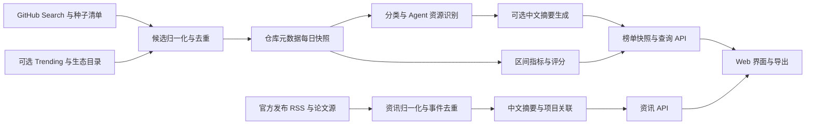

# GitHub Rank 开发方案

版本：v0.9，2026-11-01。已完成本地浏览、项目维护、调度、资源增强、资讯详情与事件修订，并新增收藏更新、阅读状态和摘要评估准备。具体实现、未完成项与取舍见 [实施状态](IMPLEMENTATION.md)，实际证据见 [验证报告](VALIDATION.md)。本文件保留完整目标范围，不能将所有设计条目理解为已实现。

本轮完成：[收藏与阅读](LIBRARY.md) 的稳定 ID 更新、版本感知已读、筛选、旧收藏迁移、备份导入/导出；[摘要评估包](SUMMARY_EVALUATION.md) 已准备 70 条真实输入。没有真实模型输出，报告不填充质量分。schema 保持 v5。最终运行检查发现采集进程已中断，已通过启动器恢复，详见验证报告。

接下来按依赖顺序推进：

1. 完整元数据及多资源扫描覆盖：利用现有预算和 API 条件补齐，并记录扫描范围和失败原因；不将部分覆盖描述为全量。
2. 真实样本审阅：抽查资讯分组与分类；配置已有模型后，对固定输入的摘要做事实、中文表达和实用性审阅，并记录耗时/用量。评估包已经就绪，实际模型质量仍未验证。
3. 持续运行：核对来源成功/失败恢复及调度重启窗口，累计独立的 48 小时证据；不以单元测试替代真实运行观察。
4. 历史成熟后验证 7/30 天增长榜和跨周期潜力基线；自然周/月刊、站内 RSS 输出和订阅仍排在之后。

问题与参考组件见 [待解决问题与参考方案](OPEN_QUESTIONS.md)。最近资源验收包含 134 个真实仓库、116 条资源记录，已接通 7 个资讯/Release 来源；48 小时稳定性、真实模型摘要质量与潜力效果仍待验证。工期估算仍需按后续实测校准。

## 1. 产品目标与首版边界

帮助用户在几分钟内了解本周/本月热门项目、值得观察的潜力项目、AI Agent 生态工具，以及当前 AI 领域的重要发布和研究进展。

默认中文、个人或小团队自托管、浏览无需登录。MVP 提供响应式 Web 界面及可手动执行的数据任务，不依赖付费模型才能运行。

首版包括：

1. 分类热门榜：最近 7 天 / 最近 30 天，按观测净 Star 增长排行。
2. 潜力榜：结合增长率、加速度、Fork 变化、开发近期活动和资料完备度，给出可解释分数。
3. AI Agent 专栏：框架、Coding Agent、MCP、插件、Skills、工作流/评测工具。
4. 项目卡片：80—150 字中文介绍、适用场景、入选理由、关键指标、原仓库与官网链接。
5. 搜索筛选：关键词、类型、语言、Star 范围、许可证状态、是否归档、观察状态。
6. 项目详情、历史榜单、浏览器本地收藏、Markdown/JSON 导出。
7. AI 前沿资讯：聚合官方发布、研究论文和开源动态，提供中文简要介绍、原文、分类、时间与关联项目；默认关注最近 24 小时，也可切换近 7 天/30 天。

后续迭代：自然周/月刊、本站 RSS 导出、订阅通知、自然语言语义检索、个人偏好和候选反馈。上游 RSS/Atom 采集属于首版资讯能力。首版不需要用户账户系统。

## 2. 信息架构与交互

| 页面 | 用户看到的主要内容 |
| --- | --- |
| `/` | 本周热门、潜力项目、Agent 专栏精选、AI 资讯速览；分别显示仓库与资讯更新时间 |
| `/rankings` | 热门/潜力切换；7 天/30 天切换；分类筛选；卡片/表格；同口径历史名次变化 |
| `/agents` | 固定独立入口；按资源类型、用途、适配生态筛选；仓库榜与资源目录分开展示 |
| `/news` | AI 前沿资讯独立入口；按最近 24 小时/7 天/30 天、主题、来源筛选，支持最新/重点视图 |
| `/news/:id` | 中文摘要、事实与简要解读、原文与相关报道、实际发布时间、关联论文/模型/仓库 |
| `/projects/:owner/:repo` | 中文摘要、用途、净增长曲线、评分明细、来源、许可证与项目状态 |
| `/resources/:id` | Skill/插件/MCP 的原始路径、关联仓库、用途、兼容声明证据、可用的资源级指标 |
| `/archive` | 已生成榜单快照与周期；不因之后数据变化自动改写过去的榜单 |
| `/saved` | 本地收藏、筛选与导出 |

顶部固定导航：发现 / 热门 / 潜力 / AI Agent / AI 前沿资讯 / 历史 / 收藏。列表页使用紧凑卡片，默认每类 Top 20，支持继续加载。分类、周期、排序和搜索词进入 URL，刷新或分享后可恢复。

每张卡片至少回答“做什么、适合谁、为什么值得看”，并直接提供 GitHub 链接。指标显示“近 7 天净增 +123”，而不是含义不明的“热度 123”。无历史数据显示“观察中”。

## 3. 分类体系

使用“一个主分类 + 多个用途标签 + 独立 Agent 资源类型”的模型。主分类用于避免同一项目在总览反复出现；标签支持交叉发现。

初始主分类：AI/机器学习、开发工具、前端、后端、数据/数据库、DevOps/云原生、安全、效率/桌面应用、移动/游戏、学习/资料。

Agent 专栏与主分类正交：一个开发工具也可以拥有 Coding Agent、插件等标签。Agent 子类包括：

- Agent 框架与编排。
- 编程助手与 Coding Agent。
- MCP Server / Client 与工具连接。
- 插件、扩展、Hooks。
- Skills 单体与 Skills 集合。
- 工作流、记忆、评测、可观测性与沙箱。

分类先用 GitHub Topics、描述、README、manifest 与路径规则；不确定项进入“待分类”。可选模型辅助分类必须保存依据与置信度，人工覆盖优先，规则和分类均版本化。

Agent 适配生态记录为独立字段，例如 Claude Code、Codex、Cursor、Copilot、其他；区分“作者声明适配”和“已测试适配”。仅凭通用格式不标记为已验证兼容。

## 4. 数据采集与发现策略

### 4.1 首版采集链路



候选发现不能只靠 Trending。每天同时查询：近期创建的项目、近期有推送的成熟项目、各分类 Topics、Agent 关键词和指定生态来源；并允许用户手工添加仓库观察。

查询按创建时间、Star 区间和 topic 分片，处理重复、1,000 条上限和 `incomplete_results`。记录每个发现任务的 query、时间、截断/失败状态。对外称“已跟踪候选池排行”，不宣称全 GitHub 无遗漏。

试运行目标跟踪约 1,000—3,000 个仓库；规模以首阶段限流和耗时验证为准。设置按分类的候选配额，保留少量低 Star 新项目探索名额；不将近期无推送作为热门榜的统一发现门槛。

仓库稳定 ID 是主键，名称/owner 作为可变属性，保存重命名和迁移别名。默认排除归档、禁用和明显镜像；Fork 默认不进榜，可手动加入。资料合集保留在学习/资料分类，不与可运行工具混成一个类别。

### 4.2 调度与故障处理

- 每日北京时间 08:00 启动批次；每条观测保存实际 UTC 时间，界面转换到 Asia/Shanghai。
- 观测总数每天更新；README/目录/manifest 根据 SHA/ETag 与缓存状态更新；不为所有仓库每天下载全部文件。
- 搜索与普通 API 分别管理预算，读取限流头；403/429 按原因处理，遵循 Retry-After 并指数退避。
- 每个仓库、日期和任务类型使用幂等键；单写入任务锁，防止重复调度；单源失败不阻断其他来源。
- 任务完成后原子发布榜单；部分失败时保留上一成功版本并显示过期/覆盖状态，不将失败值写成 0。
- Token 留在服务端环境变量中；日志不包含凭证。浏览器访问本站 API，避免泄露上游 Token。
- 资讯任务独立运行：支持较频繁更新的源默认每 30 分钟检查，论文源按其实际发布节奏配置；使用独立任务锁与失败状态，不影响每日仓库快照。轮询不等于实时到达承诺。

3,000 个仓库每天一次基础请求约需 3,000 次调用，额外预算用于分页、重试和内容更新；不能假定搜索额度和内容请求免费。开发阶段实测并将预算控制在实际额度内，必要时分小时执行。

### 4.3 冷启动与历史数据

第一天即可提供真实当前元数据、候选目录与中文介绍。无历史项目显示“观察中”，可单独按当前总 Star 或创建时间浏览，但明确排序名称。

已有合规历史快照且能核对口径时才导入。外部 Trending 指标放在带来源的参考模块，绝不与自采净增长拼成一条时序。

自采满 7 天后可生成完整 7 天增长，满 30 天后生成 30 天增长；潜力榜加速度分别需要 14/60 天端点。等待历史积累属于数据成熟时间，不等同于代码开发工期。

## 5. 周榜/月榜与评分口径

### 5.1 时间与准确性

MVP 主要展示滚动最近 7 天和 30 天，界面直接显示该名称；后续自然周定义为北京时间周一 00:00 至下周一 00:00，自然月为月初至次月月初，月刊另建统计边界采样任务。

每日榜单使用已完成批次的实际端点；端点与目标时间误差均不得超过 6 小时，并展示实际起止时间，标记为每日采样观测值。任何端点缺失就不进入该周期正式榜，不能用更短区间冒充整周/整月，也不把漏采插值当作实测。

保存整个周期的日快照覆盖率。仅有两个端点时可展示净变化，但缺口处的图表断线；潜力榜默认要求至少 90% 日覆盖率。当前端点超过 36 小时则标记过期并保留此前榜单。

### 5.2 热门榜

令 W = 7 或 30 天，S 为 Star 总数，F 为 Fork 总数：

```text
delta_stars_W = S(end) - S(start)
delta_forks_W = F(end) - F(start)
growth_rate_W = delta_stars_W / max(S(start), 100)
```

热门榜首先按 `delta_stars_W` 降序；并列时按 `delta_forks_W`、稳定仓库 ID 排序。只纳入正净增长且端点合格的项目。总 Star 作为背景指标，不主导区间榜。

总数差是“净增”，包含取消 Star 的影响，不声称是期间所有新增 Star 事件数。原始负增长照实保留在详情中；可疑突变打观察标签，不声称凭聚合数据就能识别刷 Star。

### 5.3 潜力榜 v1

潜力是发现启发式，不是对未来流行程度的保证。初始入围条件为当前 Star 50—20,000、周期净增至少 20（7 天）或 50（30 天）、最近 30 天有 push、完整双周期端点、日覆盖率至少 90%。全部阈值可配置；已归档项目排除。

```text
previous_delta = S(start) - S(previous_start)
acceleration = (delta_stars_W - previous_delta) / max(abs(previous_delta), 20)

G = percentile(growth_rate_W)
A = percentile(acceleration)
F = percentile(max(delta_forks_W, 0))
D = exp(-days_since_last_push / 30)
Q = 0.5 * has_nonempty_readme + 0.5 * has_documentation_or_demo_link

potential_score = 100 * (0.40*G + 0.25*A + 0.15*F + 0.10*D + 0.10*Q)
```

percentile 为 0—1 的平均秩百分位，同值取平均秩；在同主分类、同周期候选集合计算。少于 30 个合格样本时回退到全站同周期集合，并显示评分参照范围；全站仍少于 30 个则只出观察列表，不发布正式潜力分。

Q 仅表示资料是否可获得，不代表资料质量；push 只表示近期推送，不当作高质量维护证明。缺失字段与 0 分分开：关键输入无法取得时进入观察列表，不静默补零。缺许可证作为使用信息展示，不直接判定项目无价值。

记录原始特征、参照集合版本、阈值、算法版本与每项贡献。推荐理由从事实模板生成，例如“近 7 天净增 150，增长率 30%，较上个周期加快”。首版先用固定权重，再用历史回放和人工抽查调整，避免一开始训练黑箱模型。

排名变动仅对同周期、同算法、同分类口径计算；之前不存在或不具资格显示“新入榜”，不假设原来排最后。

## 6. AI Agent 专栏的资源粒度

仓库与资源是两种实体：一个仓库可包含多个 Skill、插件或 MCP 服务。仓库指标留在仓库层，资源层不继承独立热度。

首版 Agent 页面提供“仓库排行”和“Skills/插件目录”两个视图。资源目录可按关联仓库的排名排序，但必须标明这一依据；没有资源级指标时，不发布所谓 Skill 独立增长榜。

识别流程：发现候选 → 获取默认分支树 → 定位 `SKILL.md`/manifest → 解析元数据 → 保存路径和 commit → 校验并去重。设置文件大小、目录深度及数量上限；树被截断时补充分目录请求，仍不完整就明确标记。

资源档案包含：类型、用途、原始 URL、所属仓库、文件路径、证据 commit、更新日期、作者兼容声明、许可证状态、可选安装量来源/日期。使用仓库 ID + 路径维持资源身份，内容 hash 识别相同版本和跨仓库副本；保留来源关系，避免重复占满目录。

skills.sh 安装量只有接口接通后才展示，并标注遥测来源；资源安装量和仓库 Star 不直接相加。若积累了资源级每日安装快照，第二阶段再设计独立安装增长榜。

## 7. 中文介绍生成

输入只取仓库描述、README 有限片段、Topics、许可证、官方链接及其对应 SHA。输出结构为“一句话用途 + 适合谁 + 1—2 个特点”，80—150 字，事实字段附来源。

模型调用是可选适配器，第一版不绑定厂商。无模型配置或调用失败时，显示原描述与基于已知字段的模板；明确标注“原文/模板/AI 生成”，不把英文原文假称为中文摘要。

当前已实现可选的本机 Ollama 结构化适配、逐字引用校验、输入 hash 缓存和每日调用次数上限，详见 [摘要配置](SUMMARIES.md)。实际模型质量仍需在配置服务后验证。

只对入榜项目及用户主动打开的候选生成摘要；按 README SHA + 提示词版本 + 语言缓存，每日额度可配置。README 更新导致旧摘要过期时展示状态并排队重建。

仓库文本是待处理数据，里面的命令或提示不执行；摘要流程没有安装/运行第三方代码的工具权限。只展示可验证链接，Markdown/HTML 经清洗，不根据 README 宣传臆造性能或兼容结论。

## 8. 技术架构

建议使用 Python 采集与分析后端、React Web 前端：

| 层 | 建议 | 选择原因 |
| --- | --- | --- |
| 前端 | React + TypeScript + Vite；首版日曲线使用 SVG | 列表与筛选交互清晰，静态构建便于部署，简单曲线减少依赖 |
| API | FastAPI + Pydantic | 采集、评分和接口共用数据模型 |
| 存储 | SQLite + 标准库 sqlite3；schema version | 单机起步减少依赖；下一版 schema 增加显式迁移；多实例写入需求明确后评估 PostgreSQL |
| 采集 | httpx；独立命令行任务 | 限流、重试和断点任务易测试 |
| 调度 | 本机任务计划 / Linux cron；任务锁 | Windows 可运行，Docker 部署时也不依赖后台浏览器 |
| 检索 | 首版数据库筛选与规范化关键词匹配 | 避免中文分词、向量服务成为首版前置依赖 |
| 交付 | Docker Compose；API 提供前端构建产物 | 单机持久卷部署；开发时前后端分别启动 |

具体依赖版本在开始编码时选择并锁定。首版不引入 Redis、Celery、独立向量数据库等服务。

SQLite 数据库置于持久卷，启用适当并发与备份设置；任务进程单写入，API 主要读取发布好的榜单。自动备份使用 SQLite backup API 或一致性导出，不能直接复制正在写入的文件并假定可恢复。

拟定目录：

```text
backend/
  app/api/            # 榜单、项目、资源、资讯、归档查询
  app/collectors/     # GitHub、生态目录、RSS/Atom 与资讯适配器
  app/classifiers/    # 分类和资源识别
  app/ranking/        # 时间窗口、特征、评分
  app/summaries/      # 模板与可选模型适配器
  app/news/           # 资讯事件去重、主题与项目关联
  app/models/        # 数据模型
  app/jobs/          # 可重入数据任务与发布
  migrations/
  tests/
frontend/src/
config/              # 分类、种子、查询与评分配置
docs/
docker-compose.yml
```

## 9. 核心数据表与 API

| 表 | 关键内容 |
| --- | --- |
| repositories / repository_aliases | GitHub ID、当前名称、别名、原链接、创建/推送时间、许可与状态 |
| repository_snapshots | 仓库 ID、实际观测时间、批次、Star/Fork 等总数、来源；保留原始净变化依据 |
| discovery_runs / discovery_hits | 查询、候选来源、分页和完整性状态、发现时间 |
| contents / classifications | README/manifest hash、分类证据、分类版本、人工覆盖 |
| agent_resources / resource_versions | 类型、路径、所属仓库、内容 hash、证据 commit 与兼容声明 |
| resource_metric_snapshots | 可选的资源级安装量、来源、时间；不与仓库指标混用 |
| summaries | 语言、正文、输入 SHA、生成方式、提示词版本、来源 |
| ranking_runs / ranking_entries | 周期、实际端点、算法版本、参照集合、分数、资格、发布状态与名次 |
| job_runs | 时间、成功/失败数、重试、限流、耗时及脱敏错误 |
| source_preferences / summary_attempts | 来源启停覆盖配置；北京时间每日摘要调用预算、成功/失败状态和 Token 计数 |
| news_sources / news_items / news_item_versions | 来源配置、原始链接、标题、发布/抓取/更新时间、摘要依据与内容版本 |
| news_events / news_event_items | 同一事件的多来源聚合、主题、重要程度依据、主来源和修订状态 |
| news_entity_links | 资讯与仓库、Agent 资源、论文及模型的关联与匹配证据 |

索引覆盖仓库 ID + 时间、分类 + 周期 + 排名、资源所属仓库；快照按日增长，原始内容按 hash 去重。收藏先存浏览器，无服务端个人数据表。

只读 API 初稿：

```text
GET /api/rankings?kind=hot|potential&window=7d|30d&category=...&run_id=...
GET /api/projects?q=...&language=...&min_stars=...&status=...
GET /api/projects/{owner}/{repo}
GET /api/projects/{owner}/{repo}/history
GET /api/agent-resources?type=skill|plugin|mcp&ecosystem=...
GET /api/agent-resources/{id}
GET /api/news?window=24h|7d|30d&topic=...&source=...&sort=latest|important
GET /api/news/{id}
GET /api/library?projects=数字ID,...&resources=资源ID,...&news=资讯ID,...
GET /api/news/sources
GET /api/archives
GET /api/data-status
GET /api/exports?run_id=...&format=json|markdown
```

响应包含 `as_of`、实际周期、数据覆盖状态和来源。筛选值使用白名单与分页；数据刷新、人工修改通过服务器命令完成，首版不暴露公共管理接口。

## 10. 分阶段实施

工期为单人专注开发的初始估算，需根据第一阶段验证调整；不包含 7/30/60 天的数据积累等待时间。

| 阶段 | 工作 | 可验收交付 | 预计 |
| --- | --- | --- | --- |
| 1：数据验证与骨架 | 验证元数据、搜索限流、内容/目录识别及首批资讯源；建立数据库和 CLI；约 100 个多类型真实仓库试采 | 手动运行一批，生成真实快照与采集报告；逐项确认外部可选源是否可用 | 1—2 天 |
| 2：发现与评分 | 分类、候选扩展、快照、周期计算、评分和原子发布 | 在历史测试数据上验证榜单；真实数据不足的项目显示观察中 | 2—3 天 |
| 3：Web 与 Agent 专栏 | 榜单、筛选、详情、资源目录、摘要、收藏、导出 | 完整浏览闭环，可从列表进入原仓库和具体 Skill 文件 | 3—4 天 |
| 3b：AI 前沿资讯 | 官方/论文源接入、事件去重、新闻页、中文摘要、项目关联 | 独立资讯入口、真实时间与原文、同事件合并、来源失败状态可见 | 2—3 天 |
| 4：运行与交付 | 调度、故障降级、备份恢复、容器部署、文档 | 本地启动和自托管部署可复现；核心测试与浏览器验收通过 | 1—2 天 |

包含 AI 前沿资讯后，合计约 9—14 个工作日的首版开发。建议首先完成可持续采集，再完善页面，这样开发期间也能开始积累历史。

## 11. 验证与验收

必要自动化测试针对核心风险：时间边界、缺失端点、负增长、平分、候选不足、分类回退、算法版本、重复任务、仓库重命名、429 退避、部分源故障与原子发布；使用可控 API 响应，另做小规模真实接口冒烟。

前端通过类型检查和生产构建，并做桌面/手机浏览器流程验收。性能目标为本地部署、已缓存的榜单查询 P95 小于 500ms；这是实现目标，须在明确机器和数据规模下测量。

首版完成标准：

- 热门/潜力、7 天/30 天与分类筛选可组合，URL 可恢复筛选。
- AI Agent 是独立固定入口，Skills/MCP/插件的来源路径可直接打开。
- AI 前沿资讯是独立固定入口，支持时间/主题/来源筛选；新闻均有原文与时间依据，同事件多篇报道聚合，论文预印本和作者自述结论明确标注。
- 资讯新鲜度、缺失时间、来源失效、更新/撤回均可见；冷启动不把历史文章当作今日新闻，关联仓库只能来自可验证的匹配证据。
- 每个正式榜条目有可复核指标和来源；观察中、过期、部分覆盖均可见。
- 有模型时生成有依据的中文简要介绍；无模型时原文/模板降级可正常使用。
- 多 Skill 仓库不为每个 Skill 伪造 Star 或独立热度。
- 手动和定时任务都可重复执行，失败可重试；重启不丢历史数据。
- 生产榜不含演示数据；开发用历史夹具与真实采集分库隔离。
- Docker 部署、环境变量、备份恢复和数据口径有说明。

## 12. 默认决策与后续校准

默认按中文个人工具实现，支持后续公开部署；默认 SQLite 单机、仓库每日采集、资讯按源更新、模型可选、不接消息推送。此阶段无需预先提供账号凭证。

编码开始时可先完成不依赖凭证的骨架、测试与采集命令；真实持续采集需要服务端可用 GitHub Token，中文 AI 摘要需要所选模型配置。skills.sh 与其他可选源接入失败不阻塞核心版本。

上线后观察候选漏检、分类准确率、重复资源占比和用户保存/点击反馈；至少积累一个月数据，再评估潜力分是否能发现后续持续增长的项目。回放时只能使用当时已观测到的信息，避免未来数据泄漏。
