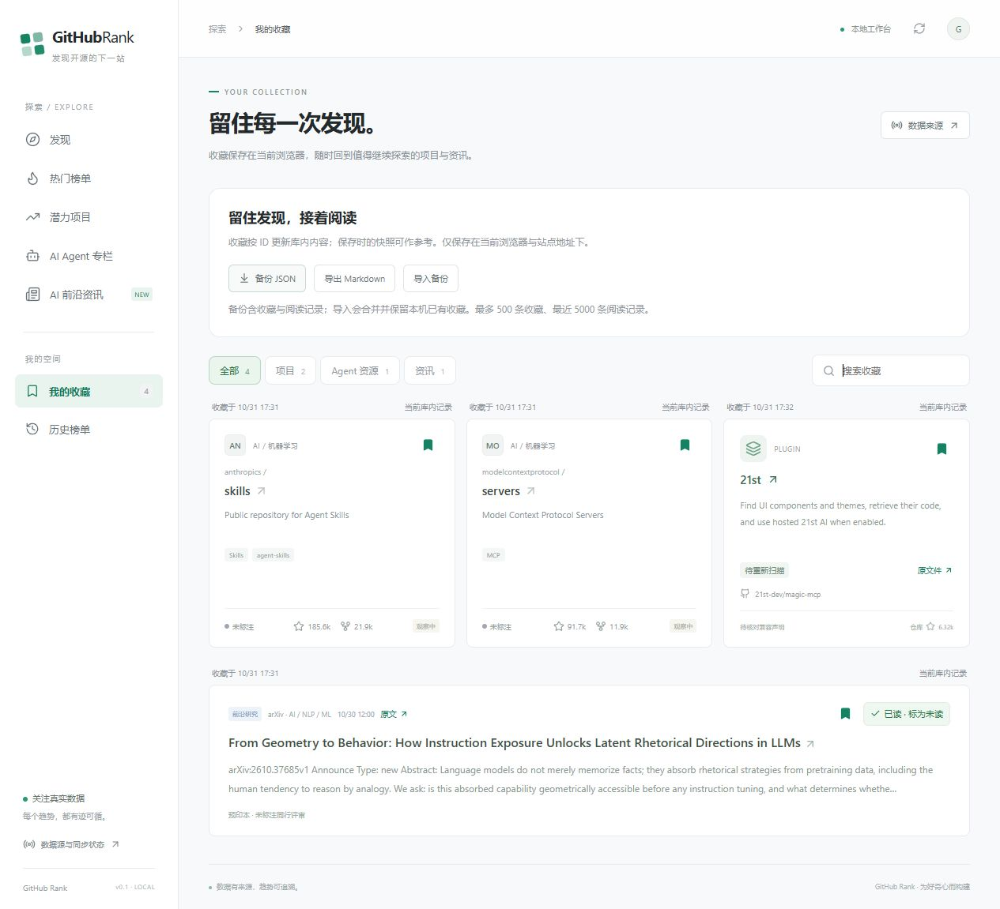

# 本机收藏与阅读

更新：2026-11-01。借鉴成熟阅读器的显式已读状态、筛选及备份流程，在现有浏览器收藏基础上实现；无需增加账号服务。

## 日常使用

- 项目、Agent 资源和资讯卡片均可收藏。在“我的收藏”按类型、关键词筛选，资讯类型还可按阅读状态筛选。
- 收藏保留稳定 ID、原始介绍快照与保存时间。打开收藏页时批量读取最新库内记录；项目改名仍按 GitHub 数字 ID 查找，不会误指向复用旧名称的新仓库。
- 库内缺失、已排除、暂时无法更新分别提示。缺失或请求失败时仅展示保存时的参考信息和来源链接；不拿旧指标或 AI 摘要冒充当前数据。保存时的链接可能失效。
- 资讯列表和详情支持手动“标为已读 / 标为未读”。打开详情不会自动标记已读。当前条目的内容版本与已读 hash 不同时显示“有更新”；“未读 / 有更新”包含这两种状态。
- 历史详情按实际查看版本标记，不会替之后的版本标记已读。状态针对单条来源报道，不自动扩散到同事件的其他报道。内容 hash 覆盖本地解析内容与元数据，变化不一定代表作者修改正文。
- 阅读筛选应用于当前 API 已加载结果，页面单独给出匹配数量；不宣称已加载整个资料库。类型、关键词、阅读筛选可由 URL 恢复，个人状态仍留在浏览器。

## 备份与迁移

“备份 JSON”包含收藏与阅读记录，可在另一浏览器或站点地址下“导入备份”。导入先校验再合并，同类型和 ID 的收藏保留本机已有快照，阅读标记保留较新的时间；重复导入不增加重复收藏。最多 500 条收藏、最近 5000 条阅读记录，单文件不超过 4 MiB。

“导出 Markdown”输出保存时的来源快照，适合个人笔记；最新指标应在应用内查询。Markdown 不用于恢复阅读状态。

旧版 github-rank:saved 数据首次读取时自动解析，不编造保存时间。首次成功修改后写入新键 github-rank:library:v1；旧键保留作备份，新键优先。非法备份、存储空间不足或存储不可用时，写入失败保留原记录。损坏的本机记录不会被空列表自动覆盖；收藏页可导出原始文本排查，或显式导入有效备份恢复。

数据使用 [localStorage](https://developer.mozilla.org/en-US/docs/Web/API/Window/localStorage)，按协议、主机和端口隔离。localhost 与 127.0.0.1、8000 与备用端口均视为不同来源；切换启动地址前先导出备份。清除站点数据会丢失本机状态，浏览器隐私模式可能只在当前会话保存。没有账号同步，多标签页通过 storage 事件接收变更，同时写入仍以最后一次成功写入为准。

GET /api/library 只解析所给项目、资源和资讯 ID，不向数据库写入个人收藏或阅读状态；单请求最多 200 个引用，前端每批 100 个。此功能只保证获取当前库内记录，不会为每条收藏额外请求 GitHub。

