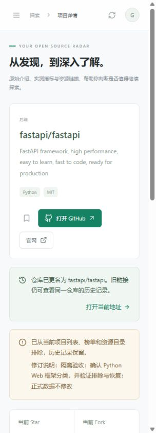
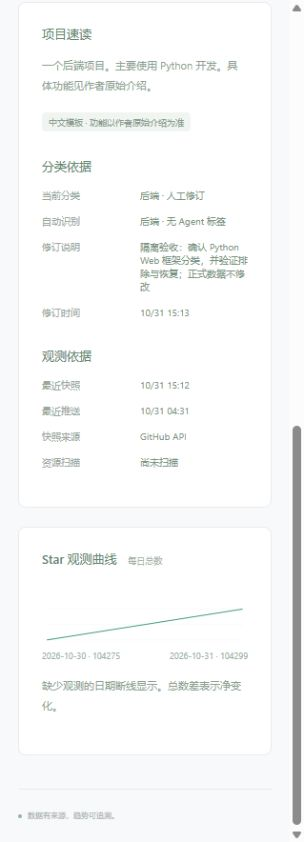
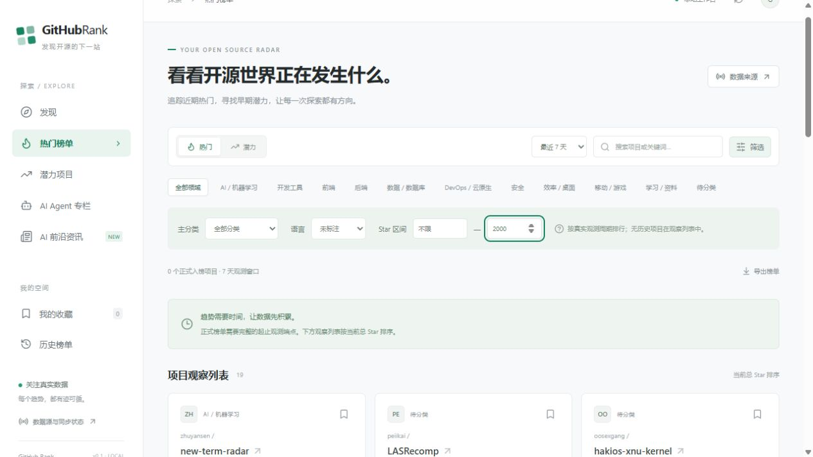
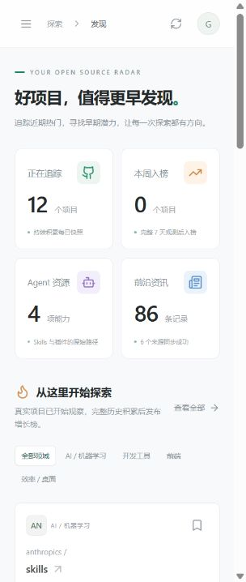

# 首轮验证报告

日期：2026-10-30（Asia/Shanghai）。这是首个本地可运行版本的验证记录，不代表全部产品目标已完成或完成长期运行验证。

## 最新：项目维护与改名验证（2026-10-31）

新增项目维护命令，单仓库添加、分类/Agent 标签覆盖、排除/恢复、修订历史和重置。原始采集数据与人工覆盖分离，实时列表/榜单/导出共用生效规则；已发布榜单保持不变。

真实数据库升级前通过 SQLite backup API 保存 `data/backup-pre-v3-20261031.sqlite3`。v2→v3 升级后 `integrity_check=ok`，100 个仓库、100 条快照、51 个资源、111 条资讯、8 个归档、0 条模型摘要数量均保持不变。

随后执行真实 `projects add https://github.com/tiangolo/fastapi`，返回仓库 ID `160919119`、当前名称 `fastapi/fastapi`，任务成功且无警告。追加真实 2026-10-31 快照，已有首日快照未覆盖；当前数据库为 100 个仓库、101 条快照，其余内容数量不变。正式库未写入人工测试覆盖。

完整后端测试 56 项通过，TypeScript/Vite 生产构建通过，19 个本机 HTTP API/页面地址均返回 200；另外验证排除后隐藏、恢复后可见，且分类筛选与导出一致。新增用例覆盖：公开地址验证、拒绝私有仓库、任务失败记录、重复采集、修订跨刷新保留、恢复最新自动分类、筛选与导出一致、排除不影响旧归档、不将排除项目作为潜力参照、同 ID 改名、旧名复用、资源固定 commit 链接、迁移保留历史/来源偏好、CLI 清空标签和任务锁。

浏览器使用真实数据库的隔离副本，验证旧地址进入当前仓库、改名提示、“打开当前地址”跳转、排除提示、指标排除状态，以及分类依据、修订说明/时间。窄屏长文本可换行，浏览器未记录错误。以下截图包含隔离验收修订，不能视为正式库的人工分类状态。

本轮未配置实际模型，未执行 48 小时连续运行，也没有用测试数据填充生产历史。

## Windows 快捷启动验证

新增根目录 `启动.cmd` / `关闭.cmd` 及后台启动器。通过 `scripts/verify_launcher.py` 在隔离状态目录与本机端口验证：后台就绪检查、端口冲突避让、重复启动复用、PID 创建时间不匹配时保留进程、安全关闭自己创建的服务。验证过程未打开浏览器或弹出对话框。

另外实测两个 `.cmd` 入口：启动成功后在 8877 端口就绪；再次启动保持同一 PID；关闭入口成功结束测试服务。相关 8 项 API 回归检查通过。

启动器只监听本机，读取项目 `.env`，健康检查同时核对应用、工作区和本次实例标识；未写入开机启动项或修改系统设置。

## 最新：第二阶段验证

截至北京时间 21:24：真实数据已扩展为 100 个仓库、100 条日快照、51 个 Agent 资源、111 条原始资讯/Release 记录。7 个来源均有成功记录，DeepMind 已切换到实测可用的官方 RSS。

六条搜索查询均有真实返回，按各查询前 20 项轮流接纳候选，并记录 bounded/incomplete 状态；另从官方 MCP 列表解析 14 个候选链接。当前样本有 5 个 API 完整元数据记录与 95 个公开页面降级记录，完整扫描标记为 3 个；不能宣称语言、许可证和资源清单全部完整。

后端测试扩展到 36 项通过，新增覆盖：v1→v2 迁移保留数据、已跟踪仓库优先刷新、来源暂停不请求、语言/Star 筛选与导出一致、搜索与核心限流独立、摘要结构化请求、无工具调用、引用校验、输入变化失效、缓存复用与失败也计入每日上限。前端生产构建通过，Compose 配置通过校验。

再次检查 17 个本机 API/页面地址均返回 200。100 仓库、20 次暖进程榜单请求的 P95 为 61.08ms，不能外推到其他机器或更大规模。模型服务未运行；摘要的实际生成质量仍未验证，生产库摘要数为 0。

浏览器验证新增“语言=未标注、Star≤2000”组合筛选，显示 19 个观察项目；URL 和导出链接均保留相同筛选条件。未发现浏览器错误日志。

以下保留首轮记录，便于区分不同阶段的实际证据。

## 1. 真实采集结果

截至北京时间 18:11 的本地状态：

| 数据 | 结果 |
| --- | --- |
| 项目 | 12 个真实公开仓库 |
| 日快照 | 12 条，每仓库仅首次成功观测；重复采集不覆盖当日历史 |
| Agent 资源 | 4 个 Skills，保留原始文件路径及 commit |
| 资讯与 Release | 共 86 条原始记录，非 86 个近期独立事件 |
| 成功资讯源 | Anthropic 21、Hugging Face Blog 25、arXiv 25 |
| 成功 Release 源 | LangGraph、AutoGen、CrewAI 各 5 条，API 限流时经官方 Atom 降级 |
| 失败来源 | DeepMind：ConnectError，未伪造成功状态 |
| 正式增长榜 | 当前无足够历史，显示观察列表，不以总 Star 替代净增长 |

未配置 GitHub Token。实测共享出口的公共 API 额度已耗尽，首轮 12 个仓库改用公开页面结构化 JSON 中的精确 Star/Fork 计数；没有使用页面上的 k 缩写推算数值。

该降级缺少语言、推送时间、许可证等部分字段，保持未知；资源扫描仅从可验证链接取得 4 个 Skills，并标记 partial，不能当作这些仓库的完整资源数量。缺推送时间的项目不会进入正式潜力榜。

官方新闻只提供日期时标记“仅日期”，不冒充精确时间；精确 24 小时窗口将这类内容放到待确认区域。Release Atom 没有首次发布时间的条目同样不假造时间。尚未配置模型，页面保留英文原文摘要与中文项目模板。

## 2. 自动化验证

后端 `pytest`：24 项通过。覆盖：

- 缺少历史、超出端点容差、负净增长、双周期覆盖不足和参照集合不足。
- 平均秩、相同特征得到相同评分、不可变榜单归档。
- 每日快照幂等、资源 commit 路径、单个 Skill 不继承独立 Star/安装量。
- API 限流后的公开精确计数降级，拒绝缩写计数。
- 单个资讯源解析失败时，其他来源仍可发布，失败状态保留。
- 新闻日期/时区/日期精度、未知时间、旧闻筛选、HTML 导航排除。
- 资讯重复与内容版本保留、模型版本不误合并。
- ETag/304、本批次限流隔离、Token 不发送到其他站点、任务锁及备份恢复。
- 只读查询、参数校验、404、榜单导出和组合筛选。

当前测试依赖产生一条 Starlette 对 httpx TestClient 的弃用提示，测试仍全部通过；后续测试工具升级时处理。测试库放在 `.cache/` 的隔离目录，没有向真实数据库注入历史夹具。

前端 `npm run build` 通过 TypeScript 检查及 Vite 生产构建。Python 运行时锁与 npm 锁文件已生成；新增 CI 配置用于后续提交时执行相同检查，远程 CI 尚未运行。

## 3. 本机 API 与浏览器

通过 `scripts/verify_local.py` 检查了 17 个 API/页面地址，均返回 200，涉及项目、资源、7/30 天榜单、24 小时/7 天资讯、来源、归档、项目历史和两种导出。原始报告保存在忽略版本控制的 `data/validation-report.json`。

本机暖进程、12 个仓库、20 次连续榜单 HTTP 查询，P95 为 7.01ms；这一小样本数字不能外推至 3,000 个仓库、多用户或生产网络。

浏览器已验证：

- 窄屏首页正常显示卡片和折叠导航；1440px 桌面断点显示侧栏与多列布局。
- Agent 仓库与 Skills 目录切换，资源链接指向固定 commit 下的原文件。
- 收藏添加后在“我的收藏”可恢复，验证用收藏已取消。
- 资讯主题与关键词组合筛选：AI Agent + WebAnything 返回 1 条对应资讯，URL 保留条件。
- 项目详情可打开 GitHub，显示观察状态和 4 个关联资源。
- 历史榜单可独立打开，URL 包含对应 run_id，导出链接使用相同快照。

## 4. 部署与运行限制

`docker compose config --quiet` 通过。当前 Docker daemon 未启动，镜像构建、容器健康检查及共享卷运行尚未实测；没有启动或修改 Docker Desktop 设置。

已提供本地启动、手动采集、进程内调度、备份命令和 Docker Compose。没有注册系统常驻任务；scheduler 需要用户保持进程或容器运行。此次没有完成 48 小时持续观测，也没有积累完整周/月历史。

## 5. 下一阶段顺序

1. 配置服务端 GitHub Token 后验证搜索发现、完整资源扫描并扩大样本。
2. 在稳定运行环境执行 48 小时来源/调度/恢复观察，处理 DeepMind 连接问题。
3. 接入可替换模型摘要，评估事实准确性和预算；现有原文模式继续可用。
4. 扩充筛选、生态兼容证据、跨语言事件聚合和人工修订。
5. 历史成熟后正式发布增长榜，并对潜力评分进行跨周期基线评估。
